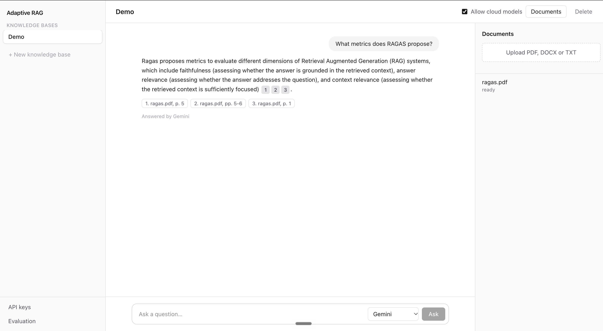
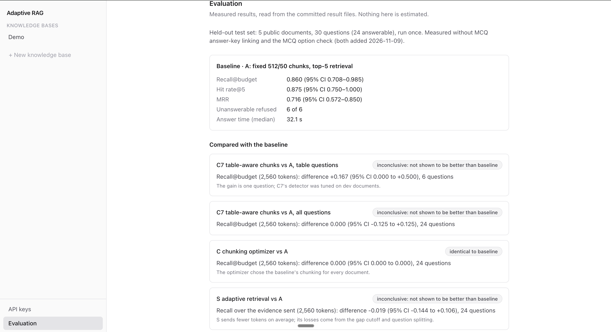
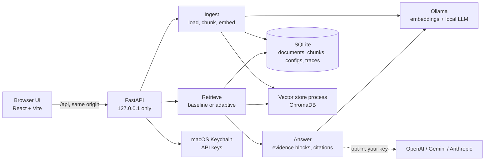

# Adaptive RAG

A local-first app for asking questions about your own documents. Every answer cites document and page, and every claim about its quality is measured on a held-out test set and reported honestly, including where the "smart" parts did not win.

Runs on a laptop (built on a 16 GB MacBook Air) with [Ollama](https://ollama.com). No paid API is needed. OpenAI, Gemini and Anthropic are optional, with your own key.



## What it does

- **Knowledge bases:** group documents (for example "MBA Materials" or "Research Papers") and ask questions within one.
- **PDF, DOCX and TXT uploads** with progress, duplicate detection, new versions, and clear errors for scanned PDFs that need OCR.
- **Grounded answers:** every answer cites document and page (or section and line). Click a citation to read the exact passage. When the evidence isn't enough, it says so instead of guessing.
- **Bring your own key:** answers come from a local model by default. A cloud model is used only if you add a key *and* switch it on for that knowledge base, because document text then leaves your machine. Keys are stored in the macOS Keychain, never in files or logs.
- **Evaluation view:** the held-out results below, in the app.

## What's different

Most RAG demos use one fixed chunk size and a fixed top-k, and say nothing about how well they work. This project treats those choices as things to **measure**:

1. **Evaluation-driven chunking.** An optional optimizer tests several chunking strategies on each document and picks one by measured retrieval quality, not by an LLM's opinion. Winning settings are cached with a profile of the document and reused for similar documents (configuration caching, not machine learning).
2. **Adaptive retrieval.** Optionally, retrieval depth adapts to the question (factual, table, multi-part, comparative), adds neighboring chunks, and stays within a token budget.
3. **Honest evaluation.** Comparisons were pre-registered and committed before the held-out run, run once, and reported with 95% confidence intervals, whatever the result.

## Results (held-out test set)

5 public documents (a 10-K filing, a Federal Reserve report, a NIST framework, two arXiv papers), 30 questions: 24 answerable, 6 unanswerable. Run once. Metric: Recall@budget, the share of the gold evidence that reaches the model within a 2,560-token budget.

**Baseline A** (fixed 512-token chunks, top-5): Recall@budget **0.860** (95% CI 0.708–0.985); all 6 unanswerable questions refused; median answer time 32 s on the laptop.

| Compared with A | Questions | Difference (95% CI) | Verdict |
|---|---|---|---|
| C7 table-aware chunks, table questions | 6 | +0.167 (0.000 to +0.500) | Inconclusive: not shown to be better |
| C7 table-aware chunks, all questions | 24 | 0.000 (−0.125 to +0.125) | Inconclusive: not shown to be better |
| C chunking optimizer | 24 | 0.000 | Identical: it chose A's chunking for every document |
| S adaptive retrieval | 24 | −0.019 (−0.144 to +0.106) | Inconclusive: not shown to be better |

**In plain words:** on this test set, neither adaptive chunking nor adaptive retrieval beat the simple baseline. Adaptive retrieval sent about 11% fewer tokens for the same quality, which is useful but not a win on recall. So the app ships with the baseline as the default, and the adaptive features are opt-in settings.

**Caveats:**
- 24 answerable questions give wide intervals. Small real differences can't be detected.
- The test questions were written by an LLM in a separate session and spot-checked by a human, not written by a human. A human-written subset is planned.
- Numbers come from [stage4_test_report](benchmarks/results/stage4_test_report_20261104T093653.json) and [stage5_test_report](benchmarks/results/stage5_test_report_20261105T152950.json). The pre-registration, every decision, and the dev-set work are in [docs/PROGRESS.md](docs/PROGRESS.md).



## Quick start

You need [Ollama](https://ollama.com), Python 3.11+ (Conda shown here), and Node.js 24 (or 22.22+).

```bash
# 1. Models (about 7.2 GB download)
ollama pull qwen3.5:9b
ollama pull embeddinggemma:300m

# 2. Backend
git clone <this repo> adaptive-rag && cd adaptive-rag
conda create -n adaptive-rag python=3.11 -y
conda activate adaptive-rag
pip install -e .

# 3. Frontend (build once)
cd frontend && npm install && npm run build && cd ..

# 4. Run
python -m adaptive_rag
```

Open **http://127.0.0.1:8000**, create a knowledge base, upload a document and ask a question.

Optional: copy `.env.example` to `.env` to change models or settings. Cloud keys can be added in the app under **API keys**.

**Tests:** `pip install -e ".[dev]"`, then `pytest` (fake providers, no Ollama needed) and `cd frontend && npm test`. `pytest -m ollama` runs the real-model tests.

## Architecture



- **Chunks** store document, order, page or line range, section heading and the chunking config, which is what makes citations and neighbor expansion work.
- **Citations** are built by the server from stored metadata, so the model can't invent a page.
- **Document text is untrusted:** it goes into delimited evidence blocks, and the model has no tools.
- **Security:** the server accepts only `localhost` requests and refuses cross-site changes. Chroma runs in its own process so that no API key can end up in its index files. The full design is in [docs/DESIGN.md](docs/DESIGN.md).

## Data sources

The benchmark PDFs are **not** included in this repo. [benchmarks/manifest.yaml](benchmarks/manifest.yaml) lists each source URL and SHA-256 hash, and `python -m adaptive_rag.evaluation download` fetches and verifies them. Question files and results contain short quotes, credited to their sources here:

| Document | Source | Licence / terms |
|---|---|---|
| Tesla 2024 10-K (dev), Apple 2024 10-K (test) | Company filings with the SEC | Company copyright; linked only, short quotes for evaluation |
| NIST AI RMF 1.0 (dev), NIST CSF 2.0 (test) | National Institute of Standards and Technology | NIST public information; credit to NIST |
| Federal Reserve Monetary Policy Reports, Feb 2025 (dev), Jun 2025 (test) | Board of Governors of the Federal Reserve System | Public domain; cite the Board |
| RAGAS (dev), RAPTOR (test), RAG best practices (test) | arXiv 2309.15217, 2401.18059, 2407.01219 | CC BY 4.0, credit to the authors |

## Background

This is v2 of my document Q&A work. The v1 prototype, [localdoc-rag](https://github.com/Pavan-1232/localdoc-rag), is a Streamlit app for a single PDF. This version adds knowledge bases, measured chunking and retrieval choices, grounded citations, and a held-out evaluation.

## Licence

[MIT](LICENSE). The Ollama models have their own licences and are downloaded by you, not shipped with this project.
